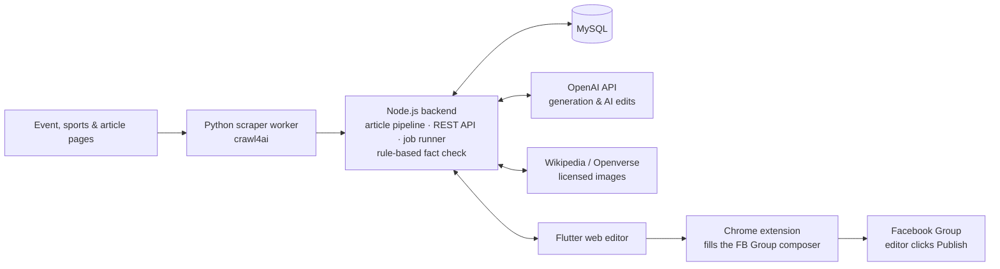

# AI Social Post Studio

**AI-assisted editorial studio that turns scraped events, sports fixtures and articles into ready-to-publish social media posts.**

Rule-based fact-checking · licensed images · the editor always in control

 

<!-- HERO GIF – replace when ready:

-->

## 📌 About

Built during my internship at **iMEDiA Group** (internal name: *iMedia Dashboard*). The app scrapes information from selected sources and turns it into engaging social media posts, mainly for Facebook – single posts and multi-item roundups – with every fact checked against a stored snapshot of the source.

The core pipeline doesn't depend on the topic – what's domain-specific are the source handlers and the formatting prompts. The current deployment covers **London events and Premier League fixtures** for a Polish-language Facebook group; per-source custom prompts are next on the roadmap, so new post types can be set up without code changes.

## 🧭 How it works

<b>🔎 Ingest</b> &nbsp;→&nbsp; <b>🗂️ Review</b> &nbsp;→&nbsp; <b>✍️ Generate</b> &nbsp;→&nbsp; <b>🧪 Check</b> &nbsp;→&nbsp; <b>✏️ Edit</b> &nbsp;→&nbsp; <b>📤 Publish</b>

## ✨ Features

| | Feature | What it does |
|:-:|---|---|
| 🔎 | **Evidence-based scraping** | A Python worker (crawl4ai) and link import collect events, fixtures and articles; dates must be backed by the source. |
| 🗂️ | **Editorial workflow** | Statuses from *needs review* to *published*, reject & restore, and a publishing queue with a calendar. |
| 📰 | **Two post types** | Single posts and roundups (events, football fixtures, mixed), each with its own format rules. |
| ✍️ | **AI editing** | *What to change?*, *Shorter* and *Proofread* appear as suggestions next to the text – Apply / Reject / Undo. |
| 🧪 | **Rule-based fact check** | Numbers, dates, times, prices, weekdays and "free entry" claims need direct evidence in the source – no LLM involved. |
| 🛡️ | **Code guards the model** | *Shorter* can't add numbers, *Proofread* keeps every number and changes at most ~25% of the text; match lines and photo credits are protected placeholders. |
| ⚽ | **Deterministic match lines** | Date, kick-off, derby flag and nearest Tube or rail station are composed by code, not the model (club list and station map for 8 London stadiums). |
| 💡 | **AI fun facts** | One interesting line per topic, validated – faulty lines (times, prices, too long) are removed automatically. |
| 🖼️ | **Licensed images only** | Wikipedia / Openverse search with automatic author attribution; copyrighted promo photos are never used. |
| 📤 | **Manual publishing by design** | No Graph API, no auto-click: the Chrome extension fills the Facebook Group composer and a human publishes. |

<b>⚙️ Engineering details</b>

 

- **Generation as durable jobs** – stored in MySQL with deduplication, deterministic retries, input budgets, `finish_reason` checks, timeouts and an optional editor hint.
- **Re-fetching with revisions** – per-source handlers combine listing cards, JSON-LD and detail pages; changed facts bump the item's revision and send it back to review.
- **Time handling** – project time zone, finished events filtered dynamically without rewriting history, "today" frozen for the duration of a generation job.
- **Prompt engineering with measurement** – quality trials on fixed sample sets before implementation; prompts pinned by SHA hash in tests.
- **Reliability & UX** – request timeouts, conflict-safe saving (on a version conflict the editor's text wins), unsaved-changes guard, no logout on transient network errors, light / dark theme.
- **Safe deployment** – Linux, PM2 behind LiteSpeed, MySQL 8.4; deploy scripts back up first and roll back automatically when the health check fails.

<!-- SCREENSHOTS – uncomment when images are in the screenshots/ folder:
## 📸 Screenshots

| Material review | Roundup editor |
|:-:|:-:|
|  |  |
| **AI suggestions** | **Publishing queue** |
|  |  |
-->

## 👨‍💻 My role

As the main developer, I took the project from an early prototype to a complete editorial workflow deployed on the company server.

- **Iterative delivery** – small, numbered stages, each closed with tests and a descriptive commit.
- **Multi-agent workflow** – one coding agent at a time (Claude Code, Codex or Cursor), an audit by a different model, then my review of the fresh diff and a verdict before every commit.
- **Testing** – ~2,400 automated tests (Node + Flutter) plus Playwright smoke scripts.

## 🔒 Source code

> [!NOTE]
> The source code is private because the app was built for a company. I'm happy to walk through the code and architecture during an interview – reach me on [LinkedIn](https://www.linkedin.com/in/antoni-krawczyk-62224539a).

The app's interface and generated content are in Polish.

